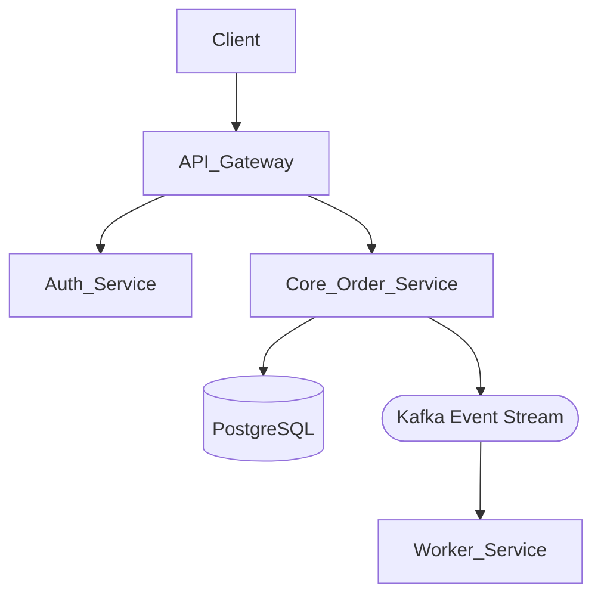

# 📘 System Mapping

:::tip

## System Mapping & Architecture Discovery

**What is it?** 
A structured analytical skill used to discover, visualize, and document software architecture topologies, component interactions, network boundaries, and data flow pathways across complex distributed environments.

#### 📚 Related Theory & Practice References
* Theory — Distributed systems architecture, service decoupling, and dependency contract management.
* Practice — Infrastructure probing, service health checks, and API mapping runbooks.
:::

## 🧭 When is it Used?

| When to Use | When Not to Use |
| :--- | :--- |
| • Onboarding onto legacy or unfamiliar codebases and multi-service cloud environments. • Preparing impact assessments for large-scale migrations or refactoring initiatives. • Documenting runtime dependencies and failure domains for architectural reviews. | • Making minor isolated bug fixes within a single well-known function or file. • Writing low-level unit tests or functional feature code. |

---

## 💡 What Value Does It Bring?

* **Reduces Architectural Blind Spots:** Exposes hidden upstream and downstream dependencies before code changes trigger unexpected outages.
* **Accelerates Context Acquisition:** Drastically cuts down onboarding time for engineers entering unfamiliar technical domains.
* **Improves System Resilience:** Clarifies single points of failure, network boundaries, and blast radiuses across production workloads.

---

## 🧠 Core Concepts

| Concept / Mechanism | Plain English Explanation | Execution Impact |
| :--- | :--- | :--- |
| **Boundary Identification** | Defining where one service ends and another begins (e.g., API gateways, database boundaries, third-party APIs). | Prevents cross-contamination of domain logic and clarifies ownership lines. |
| **Data Flow Tracing** | Following a request or payload from client entry point through internal services to persistence layers. | Pinpoints latency bottlenecks, serialization bottlenecks, and security exposure points. |
| **Dependency Graphing** | Mapping directional relationships (synchronous HTTP vs. asynchronous Kafka event streams). | Highlights cascading failure paths and critical-path dependencies. |

---

## 📋 Common Patterns

1. **Phase 1: Entry Point & Ingress Discovery** — Identify how traffic enters the system (DNS, load balancers, API gateways, ingress controllers).
2. **Phase 2: Internal Routing & Service Mesh Trace** — Map internal microservice communication pathways, RPCs, and message broker queues.
3. **Phase 3: Persistence & External Integration Audit** — Document databases, cache layers, cloud object storage, and external SaaS webhooks.

---

## 🛠️ Practical Tips & Templates

> **Template / Artifact Example:** System Mapping Markdown & Mermaid Architecture Template.

```markdown
# System Architecture Map: [System / Service Name]

## Ingress & Entry Points
- **Load Balancer:** AWS ALB (`[https://api.enterprise.com](https://api.enterprise.com)`)
- **Gateway:** Kong API Gateway (Rate-limiting & OAuth validation)

## Core Services & Downstream Dependencies


## Data Persistence & External Integrations

* **Primary Database:** PostgreSQL 15 (Multi-AZ RDS)
* **Caching Layer:** Redis cluster for session management


:::warning
### Pitfalls & Edge Cases
* **Common Mistake:** Relying solely on static architecture diagrams that quickly become outdated instead of verifying actual runtime traffic.
* **Pro Tip:** Combine static configuration reviews (like Terraform or Kubernetes manifests) with live telemetry traces from APM tools to verify the true production topology.
:::

